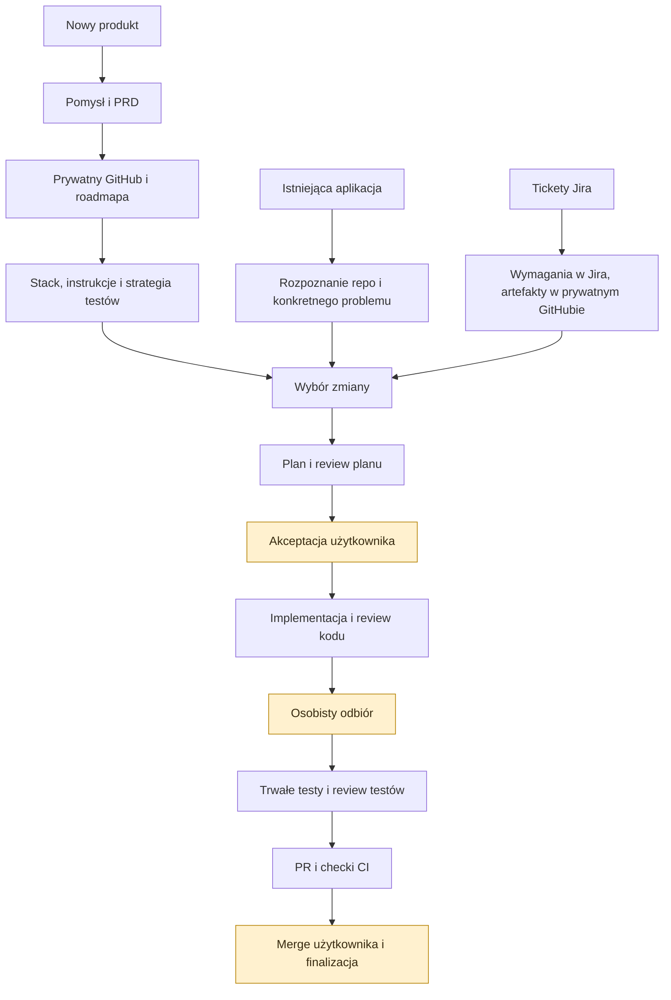
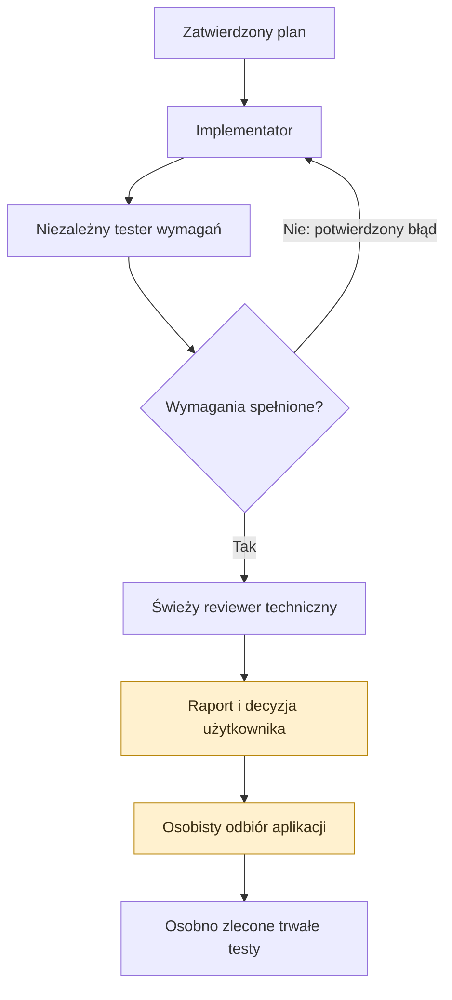
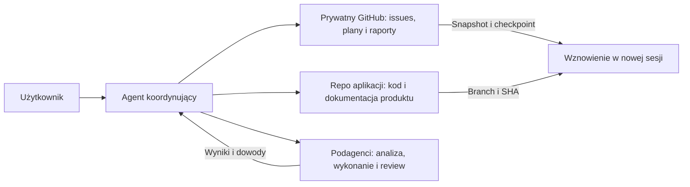

# Raven Workflow

**Od pomysłu do sprawdzonej zmiany — z agentem, świadomymi decyzjami i historią w GitHubie.**

Raven to zestaw skilli do pracy nad oprogramowaniem: odkrywania wymagań, planowania, implementacji, niezależnego review, testowania i publikowania PR-ów. Możesz używać go samodzielnie lub w zespole, w nowym produkcie albo istniejącym repozytorium.

**29 aktywnych skilli · tryby manual i auto · prywatny GitHub · wersjonowane plany i dowody**

[Instalacja](#instalacja) · [Pierwsza sesja](#pierwsza-sesja) · [Przebieg pracy](#przebieg-pracy) · [Katalog skilli](#katalog-skilli) · [Utrzymanie](#utrzymanie) · [Interaktywna mapa HTML](docs/raven-workflow.html)

> Repozytorium zawiera instrukcje i narzędzia pomocnicze dla agenta. Instalacja skilli sama nie tworzy projektu, nie uruchamia usług i nie wdraża aplikacji. Kanoniczną mapą procesu jest [raven-workflow](skills/raven-workflow/SKILL.md).

## Przebieg pracy

Trzy punkty wejścia prowadzą do wspólnego cyklu zmiany:



**Change** to jedna zmiana dostarczająca konkretny rezultat, np. eksport zamówień. Ma własne issue, wymagania, plan, fazy wykonania i raporty. **Task** to faza tego change, zapisana jako sub-issue. Przykładowe identyfikatory: `C-03` i `C-03/T-02`.

Roadmapa ustala kolejność changes. Plan opisuje realizację jednego change. Samo istnienie ticketa w roadmapie nie oznacza zatwierdzenia implementacji.

## Instalacja

### Wymagania

| Potrzeba | Co przygotować |
| --- | --- |
| Instalacja przez CLI | Git, Node.js z `npx`, dostęp do tego prywatnego repo |
| Korzystanie ze skilli | Agent obsługujący `SKILL.md`, np. Codex |
| Praca z GitHubem | Uwierzytelniony connector lub `gh`, dostęp do repo i Project osobno |
| Tryby auto i niezależne review | Host umożliwiający uruchamianie podagentów ze świeżym kontekstem |
| Implementacja i testy | Środowisko, zależności i polecenia właściwe dla projektu |
| Wariant Jira | Dostęp odczytowy do wskazanych wymagań Jira |

Procedury workflow są dołączone do tego repo. Nie wymagają instalacji innej rodziny skilli. Integracje domenowe i narzędzia zależą od wybranego zadania; np. `raven-browser` jest dostosowany do Brave na macOS i MCP `brave`.

### 1. Uzyskaj dostęp

Właściciel repo przyznaje dostęp Twojemu kontu GitHub. Możesz korzystać z istniejącego uwierzytelnienia Git/SSH lub GitHub CLI. Jeśli używasz `gh`, sprawdź sesję:

```bash
gh auth status
```

Jeżeli nie jesteś zalogowany, wykonaj `gh auth login`. Nie umieszczaj tokenów w README, promptach ani plikach projektu.

### 2. Zobacz dostępne skille

```bash
DISABLE_TELEMETRY=1 npx skills add MateuszKruk1303/raven-workflow --list
```

### 3. Zainstaluj aktywny zestaw

Instalacja interaktywna globalnie dla Codexa:

```bash
DISABLE_TELEMETRY=1 npx skills add MateuszKruk1303/raven-workflow -g -a codex
```

Wybierz **wszystkie aktywne skille Raven**, bez `raven-pilot-*` i `raven-seed`. Skille mają wspólne referencje między katalogami: sam router `raven-workflow` nie zawiera całego procesu. Zachowaj oryginalne nazwy i układ katalogów.

<details>
<summary><strong>Gotowa komenda wybierająca dokładnie 29 aktywnych skilli</strong></summary>

```bash
DISABLE_TELEMETRY=1 npx skills add MateuszKruk1303/raven-workflow -g -a codex --skill \
  raven-workflow raven-shape raven-prd raven-github-setup raven-roadmap \
  raven-init-stack raven-medusa-ecommerce-init raven-agents-md raven-test-plan \
  raven-hooks raven-repo-map raven-frame raven-research raven-domain-distillation \
  raven-rule-review raven-jira-roadmap raven-plan raven-auto-plan raven-plan-review \
  raven-implement raven-auto-implement raven-implement-review raven-test \
  raven-auto-test raven-test-review raven-pr raven-lesson raven-browser raven-md
```

</details>

Bez `-g` instalacja dotyczy bieżącego projektu — uruchom wtedy komendę w repo aplikacji. Nie używaj `--all`, jeśli chcesz pominąć historyczne skille i instalować tylko dla wybranego agenta.

Sprawdź instalację:

```bash
DISABLE_TELEMETRY=1 npx skills ls -g -a codex
```

CLI obsługuje prywatne repo oraz instalację z lokalnego katalogu. Flagi, uwierzytelnienie i aktualizacje opisuje [dokumentacja skills CLI](https://github.com/vercel-labs/skills). Zmienna `DISABLE_TELEMETRY=1` wyłącza telemetrykę instalatora zgodnie z [dokumentacją CLI](https://www.skills.sh/docs/cli). Te komendy nie wymagają publikacji repo w publicznym katalogu.

### Istniejąca ręczna instalacja

Jeżeli masz już kopie Raven w `~/.codex/skills` lub innym katalogu wykrywanym przez hosta, porównaj je z repo i zachowaj lokalne poprawki przed zmianą sposobu instalacji. Pozostaw jedną aktywną instalację każdego skilla; podwójne nazwy utrudniają ustalenie, którą wersję agent czyta. Nie nadpisuj całego katalogu skilli — mogą znajdować się tam inne zestawy.

## Pierwsza sesja

Otwórz **repo aplikacji, nad którą pracujesz**. Repo `raven-workflow` służy do utrzymywania samych skilli.

Poniższe przykłady są wiadomościami do agenta, nie komendami terminala. W Codex możesz wskazać skill przez `$nazwa`; w innym hoście użyj jego mechanizmu wyboru skilla.

```text
$raven-workflow
Sprawdź stan tego projektu i wskaż następny krok. Na razie tylko odczyt.
```

Router odczytuje instrukcje projektu i dostępny stan GitHuba. Prośba o status nie uruchamia implementacji ani całego procesu.

Gdy znasz etap i change, podaj je bezpośrednio. W przykładach `C-03` zastąp rzeczywistym Raven ID lub pełnym URL issue.

```text
$raven-auto-plan C-03
Przygotuj plan wraz z niezależnym review. Czekaj na moją akceptację.
```

Opcjonalnie dodaj do instrukcji swojego agenta zasadę:

```text
Przy pracy w workflow Raven najpierw odczytaj raven-workflow/SKILL.md
z lokalizacji wskazanej przez katalog skilli hosta. Następnie czytaj tylko
skille potrzebne do zadania. Stan change odtwarzaj z instrukcji projektu
i GitHuba, nie z pamięci poprzedniej rozmowy. Pytanie o status jest odczytem.
```

## Trzy sposoby rozpoczęcia

### Nowy produkt

1. **Dopracuj pomysł** przez `raven-shape`; uzgodnij problem, odbiorców i granice produktu.
2. **Zapisz wymagania** przez `raven-prd`.
3. **Przygotuj GitHub** przez `raven-github-setup`: prywatne repo, prywatny Project i lokalne powiązanie.
4. **Ułóż roadmapę** przez `raven-roadmap`: changes, kolejność i zależności.
5. **Uruchom projekt** przez `raven-init-stack` albo `raven-medusa-ecommerce-init`, stosownie do produktu.
6. **Przygotuj instrukcje i jakość**: `raven-agents-md`, `raven-test-plan`, a gdy istnieją odpowiednie komendy — `raven-hooks`.
7. **Wybierz pierwszy change** i przejdź do planowania.

To kolejność orientacyjna. Nie powtarzaj istniejącego setupu. `raven-init-stack` wybiera stack dla nowego projektu; istniejąca aplikacja zachowuje swój stack.

### Istniejąca aplikacja

Zacznij od konkretnego zadania. Uzupełnij brakujące powiązanie z GitHubem, a następnie dobierz analizę do niewiadomych:

| Nie wiesz… | Użyj |
| --- | --- |
| Jak poruszać się po repo i gdzie są ryzyka | `raven-repo-map` |
| Czy zgłoszona przyczyna problemu jest prawdziwa | `raven-frame` |
| Jak działa konkretna funkcja | `raven-research` |
| Czy dokumentacja i kod używają tych samych pojęć | `raven-domain-distillation` |
| Czy instrukcje dla agenta pomagają w pracy | `raven-rule-review` |

Dla małego zadania w znanym obszarze przejdź od razu do planowania. Analiza kodu w trakcie planowania nie wymaga automatycznie osobnego researchu.

**Przed ryzykownym refaktorem** można wykonać testy charakteryzacyjne przez `raven-test` lub `raven-auto-test` w trybie `before-change`. Przy bugfixie test reprodukujący błąd może prawidłowo dawać RED. Szczegóły: [testy przed zmianą](skills/raven-test/references/before-change.md).

### Jira i praca zespołowa

`raven-jira-roadmap` przenosi wskazany zakres pracy do workflow Raven. Wymagania i biznesowy status pozostają w Jira; plany, raporty i dowody trafiają do prywatnego GitHuba. Repo artefaktów może być inne niż repo kodu.

Nie importuj całego backlogu bez ustalenia zakresu. Przy oddzielnych repo używaj pełnych URL-i; finalizacja po merge wymaga jawnego powiązania. Prywatny Project nie zapewnia prywatności issues znajdujących się w publicznym repo.

## Manual czy auto?

Wybierasz tryb **dla etapu**, nie na zawsze dla projektu. Możesz przygotować plan w auto, wdrożyć go manualnie i ponownie wybrać auto dla testów.

| Etap | Manual | Auto | Decyzja użytkownika |
| --- | --- | --- | --- |
| Planowanie | `raven-plan` | `raven-auto-plan` | Zakres i akceptacja planu |
| Review planu | `raven-plan-review` osobno | Wbudowane niezależne review | Poprawki lub akceptacja wersji |
| Implementacja | `raven-implement` | `raven-auto-implement` | Zmiany kontraktu i odbiór |
| Review kodu | `raven-implement-review` osobno | Świeży reviewer po testerze | Rozstrzygnięcie uwag technicznych |
| Trwałe testy | `raven-test` | `raven-auto-test` | Zakres, błędy produktu, wyjątki |
| Review testów | `raven-test-review` osobno | Wbudowane review i poprawki wad testów | W manualu wybór poprawek |
| Publikacja | `raven-pr` | `raven-pr` | Osobne zlecenie publikacji |

**Manual** zachowuje osobne wywołania, decyzje między fazami i interaktywny triage. Może korzystać z podagentów. **Auto** organizuje pracę autorów i niezależnych oceniających wewnątrz zleconego etapu. Nie oznacza automatycznej akceptacji planu, przejścia przez wszystkie kolejne etapy ani merge.



Pętla napraw ma limity. Brak narzędzi lub dowodów nie jest sukcesem. Tester bieżącej implementacji nie zastępuje trwałej suite testowej. Auto-test naprawia potwierdzone wady testów; wykryty błąd produktu wraca do implementacji, bez osłabiania asercji.

### Przykładowy change w trybie auto

Każdy blok to osobna wiadomość, wysyłana po zakończeniu poprzedniego etapu i rozstrzygnięciu jego uwag:

```text
$raven-auto-plan C-03
```

```text
Akceptuję plan C-03 w wersji wskazanej w raporcie.
$raven-auto-implement C-03
```

```text
Sprawdziłem aplikację i akceptuję rezultat po rozstrzygnięciu uwag review.
$raven-auto-test C-03
```

```text
$raven-pr C-03
Opublikuj PR z opisem rzeczywistych zmian i wyników weryfikacji.
```

Następnie sprawdzasz CI i wykonujesz merge zgodnie z regułami projektu. `raven-pr` publikuje zmianę; nie uruchamia testów, nie audytuje poprzednich etapów i nie wykonuje merge. Obowiązkowa kolejność procesu nadal obejmuje testy i ich review przed PR.

## Gdzie znajduje się stan pracy?



| Materiał | Kanoniczne miejsce |
| --- | --- |
| Instrukcje skilli, procedury i helpery | To repo, katalog `skills/` |
| Kod, testy, migracje i konfiguracja aplikacji | Repo aplikacji |
| PRD, shape-notes, decyzje stacku, lessons, AGENTS.md | Repo aplikacji |
| Powiązanie z repo/Project i ich identyfikatory | `context/foundation/github.json` w repo aplikacji |
| Wymagania change, plan, fazy i zależności | Issues i sub-issues GitHuba |
| Wersje planów, research, review, decyzje i checkpointy | Oznaczone komentarze w GitHubie |
| Strategia testów i rozwijany cookbook | Issue strategii w GitHubie |
| Techniczny sposób uruchamiania testów | Repo aplikacji, np. `test-stack.md` |
| Lokalne kopie planów do pracy agenta | Tymczasowy `artifact_dir` poza śledzonym repo |

Koordynator publikuje wyniki; podagenci zwracają mu artefakty. Akceptacja planu dotyczy konkretnej wersji i fingerprintu. Review kodu dotyczy konkretnego SHA. Zmiana kontraktu albo kodu może wymagać nowej weryfikacji — poprzedni PASS nie przenosi się automatycznie.

Szczegółowe formaty: [kontrakt GitHub](skills/raven-auto-plan/references/github-contract.md), [adapter manualny](skills/raven-plan/references/manual-github.md), [kontrakt review testów](skills/raven-test/references/test-review.md).

### Statusy i gotowość

| Status | Znaczenie |
| --- | --- |
| Backlog | Zidentyfikowana praca, jeszcze nieprzygotowana |
| Preparing | Doprecyzowanie, analiza lub planowanie |
| Ready | Aktualny plan po review i akceptacji, spełnione zależności |
| In progress | Trwa realizacja |
| Review | Oczekiwanie na przegląd lub odbiór |
| Blocked | Konkretna przeszkoda i wskazana potrzebna decyzja lub akcja |
| Done | Wymagany zakres, odbiór i merge potwierdzone |

`Raven Order` określa kolejność, a zależności określają, co można rozpocząć. Samo zamknięcie issue albo merge nie dowodzi wszystkich kryteriów odbioru. Automatyczna synchronizacja Done wymaga konfiguracji projektu; instalacja skilli jej nie tworzy.

### Wznowienie po przerwie

```text
$raven-workflow
Wznów orientację w C-03. Odczytaj najnowszy plan, raporty, decyzje
oraz checkpoint. Wskaż ostatni ukończony etap i konkretny następny krok.
Nie rozpoczynaj jeszcze wykonania.
```

Podaj URL issue, jeśli Raven ID nie jest jednoznaczny. Agent weryfikuje GitHub i lokalny Git zamiast odtwarzać decyzje z pamięci rozmowy. Przy częściowym błędzie publikacji najpierw kończy zapis — nie powtarza wykonanej pracy ani nie tworzy duplikatu.

## Katalog skilli

Każda nazwa prowadzi do pełnej instrukcji. Czytaj główną mapę, a potem skille potrzebne do konkretnego zadania.

### Przygotowanie i nawigacja

| Skill | Kiedy używać |
| --- | --- |
| [raven-workflow](skills/raven-workflow/SKILL.md) | Ustalenie etapu, gotowości i następnego kroku |
| [raven-shape](skills/raven-shape/SKILL.md) | Dopracowanie pomysłu i zakresu |
| [raven-prd](skills/raven-prd/SKILL.md) | Przekształcenie ustaleń w wymagania produktu |
| [raven-github-setup](skills/raven-github-setup/SKILL.md) | Prywatne repo/Project, pola, etykiety i powiązanie |
| [raven-roadmap](skills/raven-roadmap/SKILL.md) | Changes i zależności na podstawie PRD |
| [raven-init-stack](skills/raven-init-stack/SKILL.md) | Nowy projekt na wybranym stacku Raven |
| [raven-medusa-ecommerce-init](skills/raven-medusa-ecommerce-init/SKILL.md) | Alternatywny setup Medusa i Next.js |
| [raven-agents-md](skills/raven-agents-md/SKILL.md) | Instrukcje dla agentów oparte na rzeczywistym repo |
| [raven-test-plan](skills/raven-test-plan/SKILL.md) | Strategia jakości i etapowe wdrożenie testów |
| [raven-hooks](skills/raven-hooks/SKILL.md) | GitHub Actions dla istniejących komend jakości |

### Rozpoznanie istniejącego projektu

| Skill | Kiedy używać |
| --- | --- |
| [raven-repo-map](skills/raven-repo-map/SKILL.md) | Szeroka mapa nieznanego repo |
| [raven-frame](skills/raven-frame/SKILL.md) | Weryfikacja obserwacji, przyczyny i proponowanego rozwiązania |
| [raven-research](skills/raven-research/SKILL.md) | Szczegółowe badanie konkretnej funkcji |
| [raven-domain-distillation](skills/raven-domain-distillation/SKILL.md) | Porównanie języka dokumentów z modelem kodu |
| [raven-rule-review](skills/raven-rule-review/SKILL.md) | Ocena jakości instrukcji AI |
| [raven-jira-roadmap](skills/raven-jira-roadmap/SKILL.md) | Wskazane tickety Jira jako kolejka pracy Raven |

### Dostarczanie zmiany

| Skill | Rezultat |
| --- | --- |
| [raven-plan](skills/raven-plan/SKILL.md) | Interaktywnie opracowany plan |
| [raven-auto-plan](skills/raven-auto-plan/SKILL.md) | Plan i niezależne review, przed decyzją użytkownika |
| [raven-plan-review](skills/raven-plan-review/SKILL.md) | Osobne review planu i triage |
| [raven-implement](skills/raven-implement/SKILL.md) | Implementacja zatwierdzonych faz z interaktywnymi bramkami |
| [raven-auto-implement](skills/raven-auto-implement/SKILL.md) | Implementacja, tester wymagań, poprawki i świeże review kodu |
| [raven-implement-review](skills/raven-implement-review/SKILL.md) | Techniczne review implementacji względem planu |
| [raven-test](skills/raven-test/SKILL.md) | Trwałe testy i dowody ich wykonania |
| [raven-auto-test](skills/raven-auto-test/SKILL.md) | Testy, niezależne review i ograniczona pętla poprawek |
| [raven-test-review](skills/raven-test-review/SKILL.md) | Niezależna ocena testów na tych samych źródłach |
| [raven-pr](skills/raven-pr/SKILL.md) | Push gałęzi i utworzenie lub aktualizacja PR |

### Narzędzia pomocnicze

| Skill | Kiedy używać |
| --- | --- |
| [raven-lesson](skills/raven-lesson/SKILL.md) | Zapis zaakceptowanej, powtarzalnej lekcji projektu |
| [raven-browser](skills/raven-browser/SKILL.md) | Weryfikacja aplikacji w Brave na macOS |
| [raven-md](skills/raven-md/SKILL.md) | Alternatywne tworzenie i aktualizacja AGENTS.md |

### Historyczny Raven Pilot

Repo zachowuje 10 skilli `raven-pilot-*` oraz `raven-seed` dla jawnie zleconej kontynuacji dawnych pilotów. Nie są częścią nowego workflow. Nie instaluj ich rutynowo i nie migruj automatycznie dawnych chunków do issues. Opis historii znajduje się w [mapie workflow](skills/raven-workflow/SKILL.md#deprecated--historyczne).

## Diagramy i interaktywna mapa

Diagramy w tym README używają **Mermaid**, renderowanego bezpośrednio przez GitHub. Nie wymagają publicznego hostingu ani zewnętrznych usług do generowania obrazów. [Obsługa diagramów w GitHubie](https://docs.github.com/en/get-started/writing-on-github/working-with-advanced-formatting/creating-diagrams).

[Mapa HTML](docs/raven-workflow.html) zawiera przełączanie scenariuszy i widok do druku. GitHub pokazuje plik HTML jako kod, a README nie uruchamia jego JavaScriptu. Aby korzystać z mapy, sklonuj repo i otwórz plik w przeglądarce. Na macOS, z katalogu tego repo:

```bash
open docs/raven-workflow.html
```

Na innych systemach otwórz plik przez menedżer plików. Mapa działa offline. Nie potrzebuje GitHub Pages ani publicznego serwera. Jej oznaczenia opisują proces i dostępność skilli, nie dowodzą gotowości aplikacji ani wykonania pełnego workflow end-to-end.

## Utrzymanie

### Struktura repo

```text
raven-workflow/
├── README.md                       # przewodnik użytkownika i zespołu
├── docs/
│   └── raven-workflow.html          # interaktywna mapa offline
└── skills/
    └── raven-*/
        ├── SKILL.md                # zakres i główne instrukcje
        ├── agents/openai.yaml      # opcjonalne metadane interfejsu
        ├── references/             # kontrakty, szablony i procedury
        ├── scripts/                # opcjonalne helpery
        └── assets/                 # opcjonalne materiały do użycia
```

Podkatalogi są opcjonalne. `references/procedures/` zawiera lokalne procedury wykonawcze; nie są osobnymi skillami do instalacji.

### Aktualizacja instalacji

Dla skilli zarządzanych przez CLI:

```bash
DISABLE_TELEMETRY=1 npx skills update -g
```

Komenda obejmuje wszystkie globalne skille zarządzane przez instalator, także spoza Raven. Możesz ograniczyć ją nazwami, np. `npx skills update -g raven-plan raven-auto-plan`. Przy zmianach wspólnych kontraktów aktualizuj spójny zestaw Raven. [Opcje aktualizacji](https://github.com/vercel-labs/skills#skills-update).

### Praca nad samym workflow

1. Edytuj skill i potrzebne referencje w tym repo.
2. Sprawdź odnośniki, zależności między skillami i zgodność trybów manual/auto.
3. Zmieniając proces, zaktualizuj router, README i odpowiedni fragment mapy HTML.
4. Zrób review diffu, commit i push do prywatnego repo.
5. Zaktualizuj instalacje użytkowników. Commit do repo nie aktualizuje automatycznie ich lokalnych kopii.

Nie synchronizuj na ślepo w obu kierunkach. Jeżeli poprawka powstała w zainstalowanej kopii, porównaj ją z repo i przenieś świadomie. `git pull` aktualizuje klon repo, a `skills update` instalację zarządzaną przez CLI. To dwa różne miejsca.

### Prywatność zespołu

Repo skilli pozostaje prywatne. Dostęp do niego nie nadaje dostępu do projektów obsługiwanych przez Raven. Repo artefaktów i GitHub Project każdego projektu mają osobno sprawdzaną prywatność. Nie publikuj mapy przez publiczny hosting ani nie wysyłaj prywatnych diagramów do internetowych edytorów.

Wersjonuj instrukcje i szablony. Dane logowania, sesje przeglądarki, lokalne sekrety i pliki cache pozostają poza repo. Użytkownik nadal odpowiada za wybór projektu i zaakceptowanie zmian zakresu.

## Najczęstsze pytania

| Sytuacja | Co zrobić |
| --- | --- |
| Instalator nie widzi repo | Sprawdź uprawnienia konta i uwierzytelnienie Git/SSH/gh |
| Agent nie widzi skilla | Sprawdź zakres instalacji, wybranego agenta i jego listę skilli; odśwież sesję |
| Skill jest widoczny podwójnie | Sprawdź ręczne kopie, instalację globalną i projektową; zachowaj lokalne poprawki przed usunięciem duplikatu |
| Brakuje referencji z innego skilla | Zainstaluj cały aktywny zestaw i zachowaj nazwy katalogów |
| Brakuje dostępu do GitHub Project | Zweryfikuj dostęp do Project osobno od repo; nie twórz zastępczego Project w ciemno |
| Nie ma lokalnego plan.md | To normalne: sprawdź issue, taski i snapshot w GitHubie |
| Nie ma obsługi podagentów | Nie deklaruj niezależnego review; wybierz wykonalny zakres i wskaż brakującą możliwość |
| Czy każda zmiana potrzebuje E2E? | Nie. Warstwa testów wynika z ryzyka; istniejące pokrycie może wystarczyć |
| Czy auto zrobi merge? | Nie. Publikacja PR i merge są odrębnymi działaniami |
| Czy można zacząć od jednego etapu? | Tak. Jawne zlecenie etapu ma pierwszeństwo przed proponowaniem całego cyklu |

---

Dokumentacja opisuje kontrakt workflow. Gdy szczegół wymaga doprecyzowania, odczytaj [router Raven](skills/raven-workflow/SKILL.md), właściwy `SKILL.md` i wskazane przez niego referencje.
