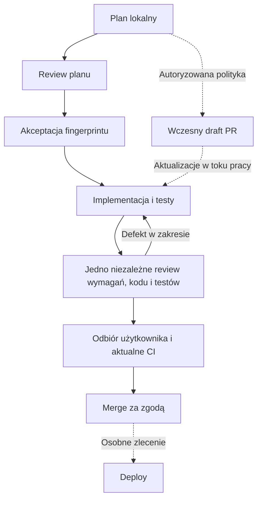

# Raven Workflow — cookbook

Raven przechowuje plan, wymagania, checklistę i checkpoint w `context/changes/<id>/plan.md`. Kod, testy i dokumenty mają wspólną historię Git. PR służy współpracy, review i CI; issues i Project są opcjonalne. Testy powstają z implementacją, a jedno niezależne review ocenia wymagania, kod i testy.

## Start i wznowienie

Wskaż repo i change ID, branch, lokalny plan albo PR. Agent zaczyna od [routera](skills/raven-workflow/SKILL.md), instrukcji projektu i krótkiego checkpointu. Nie potrzebuje historii rozmowy ani całego archiwum komentarzy GH. Nowy change domyślnie używa osobnego brancha w aktualnym checkout. Worktree służy pracy równoległej, potrzebie izolacji lub wyraźnemu życzeniu użytkownika; wznowienie zachowuje istniejący branch i katalog.

> Użyj raven-workflow. Sprawdź lokalny change C-03 i wskaż następny krok, bez rozpoczynania implementacji.

[Kontrakt pracy](skills/raven-workflow/references/change-contract.md) określa źródła prawdy, zgodę i dowody. Akceptacja dotyczy fingerprintu kontraktu (wymagania, podejście, kroki i testy). Zmiana checkboxa lub checkpointu nie unieważnia zgody; zmiana kontraktu wymaga ponownej decyzji. Planowanie/review pracują na Astra/high, implementacja i autor testów na Sol/low: [polityka ról](skills/raven-workflow/references/agent-policy.md).

## Greenfield

Shape → PRD → architektura → stack → instrukcje repo, strategia testów i CI → roadmapa → cykl change. Wybierz jeden bootstrapper (Better T Stack, Medusa lub gotowy stack). Nie odtwarzaj istniejącego setupu. Roadmapa żyje domyślnie w `context/roadmap.md` albo jednym istniejącym trackerze.

| Krok | Dane wejściowe | Wynik i miejsce zapisu |
| --- | --- | --- |
| Shape | Pomysł, rozmowa i materiały użytkownika | Uzgodniony problem i zakres w `context/foundation/shape-notes.md`. |
| PRD | Notatki i decyzje | Wymagania i kryteria produktu w `context/foundation/prd.md`. |
| Architektura | PRD i ograniczenia | Decyzje potrzebne przed implementacją w `context/foundation/architecture.md`. |
| Warsztat | Architektura i wybrany stack | Działający szkielet, instrukcje repo, strategia w `context/foundation/test-plan.md` i właściwe CI. |
| Roadmapa | Wymagania oraz działający szkielet | Kolejność samodzielnie odbieralnych zmian; szczegółowy plan powstaje dopiero dla wybranego change. |

> Użyj raven-shape. Chcę zbudować […]. Ustalmy problem, odbiorców i najmniejszy kompletny zakres produktu.

## Brownfield

Zakres lub wznowienie → opcjonalna mapa nieznanego obszaru → rzeczywiste braki instrukcji/test strategy/CI → opcjonalny frame/research/domena → plan. Mała zmiana w znanym miejscu nie potrzebuje mapowania całego repo ani Project. Jira może pozostać jedynym trackerem wymagań; Raven nie tworzy jego lustrzanych issues w GH.

| Krok | Dane wejściowe | Wynik |
| --- | --- | --- |
| Rozpoznanie lub wznowienie | Zlecenie, instrukcje repo, Git, wskazany plan/PR | Jednoznaczny zakres i następny krok; sam status niczego nie zapisuje. |
| Mapa, gdy potrzebna | Kod, testy, dokumentacja i wybrana historia Git | Lokalna mapa potrzebnego obszaru, bez pełnego skanu przy każdym zadaniu. |
| Uzupełnienie warsztatu | Istniejące komendy, runnery i CI | Sprawdzone uruchamianie oraz weryfikacja; zachowany stack i konwencje. |
| Frame/research, gdy potrzebne | Objaw, wymagania i dowody z kodu | Potwierdzony problem i ustalenia przy zmianie, bez obowiązkowego issue. |
| Plan | Wymagania, ustalenia i aktualny kod | `context/changes/<id>/plan.md` na branchu zmiany; dalej wspólny cykl. |

Istniejący projekt nie wymaga odtworzenia PRD całego produktu. Roadmapę twórz lub reorganizuj wtedy, gdy obejmuje to zlecenie.

> Użyj raven-plan. Przygotuj plan poprawki […], wykorzystując istniejący kod i testy. Pracujemy lokalnie.

## Cykl change



Manual: raven-plan → raven-plan-review, potem raven-implement → raven-implement-review. Auto: raven-auto-plan i raven-auto-implement koordynują te same artefakty oraz ograniczone pętle napraw. Rutynowe poprawki w zleconym zakresie nie wymagają pytania po każdej komendzie. Po dwóch nieskutecznych próbach tego samego problemu agent zapisuje reprodukcję i potrzebną decyzję.

Wczesny draft PR wykorzystuje wcześniej autoryzowaną politykę `.raven/config.json`; samo zlecenie taska nie daje nowych praw publikacji. Bez niej praca pozostaje lokalna, a raven-pr można zlecić dla przygotowanego wyniku. Merge wymaga aktualnych dowodów, CI, odbioru i zgody; „akceptuję, zmerguj” może potwierdzić obie decyzje. Board jest opcjonalny i niezależny od merge. Deploy pozostaje osobno.

Przykładowe osobne zlecenia dla jednej zmiany:

```text
Użyj raven-auto-plan dla C-03.
[Po review] Akceptuję przedstawiony plan. Użyj raven-auto-implement dla C-03.
[Jeżeli nie ma polityki wcześniejszej publikacji] Użyj raven-pr dla C-03.
[Po odbiorze i CI] Akceptuję wynik. Użyj raven-merge dla C-03.
```

## Artefakty i praca między sesjami

| Miejsce | Odpowiedzialność |
| --- | --- |
| `context/foundation/` | Wymagania produktu, architektura i strategia testowania. |
| `context/changes/<id>/plan.md` | Jeden kontrakt, akceptacja jego wersji, checklista i aktualny checkpoint. |
| Pliki obok planu | Research, review i raporty kontroli, tylko gdy potrzebne; PR może do nich linkować. |
| Git / branch / worktree | Rzeczywista wersja kodu, testów i dokumentów oraz ich historia. |
| PR i CI | Współpraca, feedback, wyniki kontroli i potwierdzenie merge. |
| `.raven/config.json` | Powiązanie repo i wcześniej ustalona polityka publikacji. |
| Lokalny journal runtime w katalogu Git | Odzyskiwanie przerwanych operacji; nie zastępuje wersjonowanego checkpointu. |

Jedną zmianę edytuje jeden aktywny autor, identyfikowany również przez sesję. Reviewer pracuje odczytowo; przekazanie pracy jest jawne. Lokalny mutex runtime chroni pojedynczą operację i nie jest blokadą rozproszoną między komputerami.

Przy wznowieniu agent odczytuje plan, checkpoint i rzeczywisty stan Git, a następnie potrzebny feedback PR. Niedokończona publikacja wznawia publikację, nie implementację. Brak GitHuba pozwala kontynuować autoryzowaną pracę lokalną, ale nie potwierdzić zdalnego CI ani wykonać merge.

## Sytuacje szczególne

- Niechroniony refaktor: testy charakteryzacyjne before-change; bugfix: reprodukcja i oczekiwany RED, potem GREEN na poprawce.
- Dodatkowe ryzyko auth, migracji, rozliczeń lub współbieżności: dobierz tester/audyt do konkretnego problemu. Każdy normalny change nie potrzebuje dodatkowego testera i osobnego test-review.
- Samodzielna inwestycja w testy: raven-test lub raven-auto-test; globalna strategia: raven-test-plan. Dodatkowe eksploracyjne QA: raven-manual-qa przyjmuje change, PR lub issue.
- Historia starego Raven: zachowaj artefakty. Kontynuacja ustala mapowanie jawnie; aktualizacja skilli nie migruje archiwów.

[Runtime](skills/raven-workflow/references/runtime.md) zapewnia ograniczone start/status/resume, fingerprint, checkpoint i draft PR dla już wypchniętej gałęzi. Nie zatwierdza planów, nie pushuje i nie jest silnikiem całego procesu.

## Katalog skilli

| Skill | Zastosowanie |
| --- | --- |
| [raven-agents-md](skills/raven-agents-md/SKILL.md) | Onboarding AGENTS.md z rzeczywistego repo. |
| [raven-architecture](skills/raven-architecture/SKILL.md) | Przekrojowe decyzje architektoniczne. |
| [raven-auto-implement](skills/raven-auto-implement/SKILL.md) | Implementacja, testy, jedno review i naprawy w zakresie. |
| [raven-auto-plan](skills/raven-auto-plan/SKILL.md) | Plan i niezależne review do decyzji użytkownika. |
| [raven-auto-test](skills/raven-auto-test/SKILL.md) | Osobne zlecenie testów z niezależnym review i naprawami. |
| [raven-browser](skills/raven-browser/SKILL.md) | Osobna sesja Playwright CLI, zasady dostępu do przeglądarki. |
| [raven-create-skill](skills/raven-create-skill/SKILL.md) | Projektowanie i spójna aktualizacja rodziny Raven. |
| [raven-domain-distillation](skills/raven-domain-distillation/SKILL.md) | Niezależne porównanie języka dokumentów i kodu. |
| [raven-frame](skills/raven-frame/SKILL.md) | Oddzielenie obserwacji od założonej przyczyny. |
| [raven-github-setup](skills/raven-github-setup/SKILL.md) | Potrzebny remote i polityka publikacji; tracker opcjonalny. |
| [raven-hooks](skills/raven-hooks/SKILL.md) | GitHub Actions dla rzeczywistych kontroli projektu. |
| [raven-implement](skills/raven-implement/SKILL.md) | Realizacja planu wraz z testami. |
| [raven-implement-review](skills/raven-implement-review/SKILL.md) | Jedno review wymagań, kodu i testów. |
| [raven-init-stack](skills/raven-init-stack/SKILL.md) | Better T Stack i lokalna baza. |
| [raven-jira-roadmap](skills/raven-jira-roadmap/SKILL.md) | Jira jako źródło wymagań, lokalne mapowanie bez duplikacji. |
| [raven-lesson](skills/raven-lesson/SKILL.md) | Zapis jednej uzgodnionej powtarzalnej reguły. |
| [raven-manual-qa](skills/raven-manual-qa/SKILL.md) | Dodatkowa eksploracja UI i potwierdzone reprodukcje. |
| [raven-md](skills/raven-md/SKILL.md) | Tworzenie lub aktualizacja wskazanych instrukcji. |
| [raven-medusa-ecommerce-init](skills/raven-medusa-ecommerce-init/SKILL.md) | Medusa + Next.js: lokalne monorepo i środowisko. |
| [raven-merge](skills/raven-merge/SKILL.md) | Merge sprawdzonego PR; opcjonalny tracker niezależnie. |
| [raven-plan](skills/raven-plan/SKILL.md) | Manualne przygotowanie lokalnego planu. |
| [raven-plan-review](skills/raven-plan-review/SKILL.md) | Niezależna ocena wykonalności i granic planu. |
| [raven-pr](skills/raven-pr/SKILL.md) | Wczesny draft lub aktualizacja PR, logiczne commity i zwykły push. |
| [raven-prd](skills/raven-prd/SKILL.md) | Wymagania produktu z notatek i decyzji. |
| [raven-repo-map](skills/raven-repo-map/SKILL.md) | Mapa nieznanego repo, zależności i ryzyk. |
| [raven-research](skills/raven-research/SKILL.md) | Ograniczone badanie kodu i lokalny raport dowodów. |
| [raven-roadmap](skills/raven-roadmap/SKILL.md) | Kolejność samodzielnych changes i zależności. |
| [raven-rule-review](skills/raven-rule-review/SKILL.md) | Ocena jakości instrukcji AI. |
| [raven-shape](skills/raven-shape/SKILL.md) | Dopracowanie problemu i zakresu produktu. |
| [raven-test](skills/raven-test/SKILL.md) | Osobne testy, before-change lub uzupełnienie ochrony. |
| [raven-test-plan](skills/raven-test-plan/SKILL.md) | Strategia testów, ryzyka i cookbook w repo. |
| [raven-test-review](skills/raven-test-review/SKILL.md) | Ocena konkretnych testów na zlecenie lub według ryzyka. |
| [raven-workflow](skills/raven-workflow/SKILL.md) | Router, status i wznowienie z repo. |

## Instalacja, doctor i rozwój

Repo jest źródłem dystrybucji. Python 3.10+ i środowisko lokalne:

```bash
python3 -m venv .venv
.venv/bin/python -m pip install -r requirements-dev.txt
.venv/bin/python tools/raven.py doctor
.venv/bin/python -m unittest discover -s tests -v
.venv/bin/python tools/raven.py sync --to "$HOME/.codex/skills"
# Po przejrzeniu pełnego diffu i w zakresie zgody na instalację:
.venv/bin/python tools/raven.py sync --to "$HOME/.codex/skills" --apply
.venv/bin/python tools/raven.py doctor --installed "$HOME/.codex/skills"
```

Sync obejmuje zarejestrowaną rodzinę Raven, nie inne skille. Tworzy backup dotkniętych katalogów, usuwa nieaktualne pliki tych skilli i wycofane raven-pilot-* / raven-seed. Nie zmienia globalnego AGENTS.md. Przejrzyj różnice i nie nadpisuj niezwiązanych lokalnych modyfikacji; sync nie jest automatycznym scaleniem. Symlinki i kolizje plik/katalog wymagają uporządkowania przed zapisem. Instalacja nie potwierdza odświeżenia katalogu aktywnego UI.

W globalnych instrukcjach wskaż: przy pracy Raven najpierw czytaj raven-workflow, następnie tylko skille potrzebne do zadania. Rozwijając skille, użyj raven-create-skill i dostępnego hostowi skill-creator; nie instaluj ani nie publikuj zmian bez objęcia tego zleceniem.

Doctor sprawdza frontmatter, nazwy, lokalne odsyłacze, katalog, politykę ról i [kontrakt](workflow-contract.json), a `--installed` również zgodność instalacji. `doctor --json` daje raport maszynowy. Kontrakt deklaruje zależności, nie wykonuje workflow: `initial_artifacts` to wymagane zewnętrzne dowody/decyzje, nie fikcyjne zgody. PR jest operacją boczną i nie blokuje lokalnej implementacji. Opcjonalne QA/testy/tracker są poza standardowym cyklem.

Statyczny PASS nie dowodzi zachowania agenta ani prawdziwych uprawnień, CI i gotowości aplikacji. Zmiany instrukcji wymagają właściwych testów i niezależnych prób na rzeczywistych wejściach. Workflow [Raven integrity](.github/workflows/integrity.yml) uruchamia kontrole repo; sam YAML nie ustanawia required checks w GitHubie.
