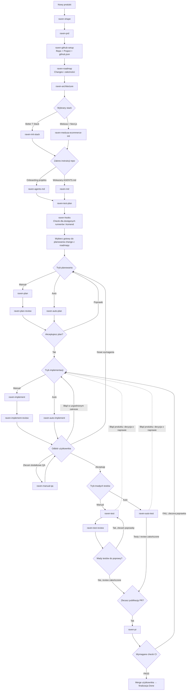

# Raven Workflow — cookbook

Raven prowadzi zmianę od wymagań do planu, implementacji, niezależnej weryfikacji i PR. Stan pracy, decyzje i dowody przechowuje w GitHubie. Skille są instrukcjami dla agenta; narzędzia w tym repo sprawdzają ich integralność i instalują spójny zestaw.

[Start](#start) · [Greenfield](#greenfield-nowy-produkt) · [Brownfield](#brownfield-istniejaca-aplikacja) · [Cykl zmiany](#cykl-zmiany) · [Przepisy](#przepisy-na-sytuacje-szczegolne) · [Katalog](#katalog-skilli) · [Doctor i synchronizacja](#doctor-i-synchronizacja)

## Start

Potrzebujesz agenta obsługującego `SKILL.md`, dostępu do repo i GitHub Project przez connector albo `gh`, a do pracy z kodem — środowiska aplikacji. Delegowanie wymaga hosta obsługującego świeży kontekst i jawny wybór modelu. Planowanie, review i niezależny tester używają **Astra/high**, implementacja i autor testów **Sol/low**. Szczegóły oraz eskalacja: [polityka ról](skills/raven-workflow/references/agent-policy.md).

Zainstaluj Python 3.10+ i zależność doctora, następnie uruchom podgląd instalacji **z katalogu tego repo**:

```bash
python3 -m venv .venv
.venv/bin/python -m pip install -r requirements-dev.txt
.venv/bin/python tools/raven.py doctor
.venv/bin/python tools/raven.py sync --to "$HOME/.codex/skills"
# Po przejrzeniu listy zmian:
.venv/bin/python tools/raven.py sync --to "$HOME/.codex/skills" --apply
```

Instalowany jest cały zestaw Raven, ponieważ skille współdzielą referencje. Sync nie dotyka innych rodzin skilli. Nadpisuje pliki aktywnych skilli zgodnie z repo, usuwa ich nieaktualne pliki oraz wycofane `raven-pilot-*` i `raven-seed`; przed zapisem tworzy kopię dotkniętych katalogów i wypisuje jej ścieżkę. Nie aktualizuje globalnego `AGENTS.md`. Sync odrzuca symlinki wewnątrz skilli oraz kolizje plik ↔ katalog przed zapisem; wymagają jawnego uporządkowania.

W instrukcjach agenta dodaj zasadę: **przy pracy w Raven najpierw przeczytaj zainstalowany `raven-workflow/SKILL.md`, następnie tylko skille potrzebne do zadania**. W nowej sesji wskaż repo i issue; nie polegaj na pamięci poprzedniej rozmowy.

Przykład pierwszego zlecenia:

> Użyj raven-workflow. Odczytaj stan issue OWNER/REPO#123 i wskaż następny krok, bez rozpoczynania implementacji.

Poniższe przykłady to prompty do agenta, nie polecenia terminala. Nazwę skilla możesz również wywołać przez `$raven-…`, jeśli host obsługuje taki zapis.

<a id="greenfield-nowy-produkt"></a>
## Greenfield: nowy produkt



Jeśli wybrano inny, już przygotowany stack, przejdź do instrukcji repo bez uruchamiania obu bootstrapperów. `raven-hooks` konfiguruje dostępne checki; po dodaniu runnerów lub suite uzupełnij go przed PR. Nie uruchamiaj ponownie gotowego setupu. Roadmapa ustala kolejność, ale nie zatwierdza planu implementacji. Nie trzeba tworzyć wszystkich testów produktu przed pierwszym change.

> Użyj raven-shape. Buduję aplikację do […]. Pomóż ustalić najmniejszy kompletny przepływ, wymagania i granice zakresu. Zapisz notatki do późniejszego PRD.

<a id="brownfield-istniejaca-aplikacja"></a>
## Brownfield: istniejąca aplikacja

Przy pierwszym wprowadzeniu Raven do istniejącej aplikacji przygotuj warsztat pracy, a dopiero potem konkretną zmianę. Zachowaj zastany stack, kod i historię.

```mermaid
flowchart TD
    START[Istniejąca aplikacja] --> BIND{Repo i Project powiązane z Raven?}
    BIND -->|Nie lub konfiguracja niepełna| GH[raven-github-setup]
    BIND -->|Tak| MAPCHECK{Aktualna mapa badanego obszaru?}
    GH --> MAPCHECK
    MAPCHECK -->|Nie| MAP[raven-repo-map]
    MAPCHECK -->|Tak| BASE{Braki w podstawach pracy?}
    MAP --> BASE
    BASE -->|Instrukcje| INSTR{Zakres instrukcji repo}
    INSTR -->|Onboarding projektu| AGENTS[raven-agents-md]
    INSTR -->|Wskazany AGENTS.md| MD[raven-md]
    AGENTS --> BASE
    BASE -->|Strategia testów| TP[raven-test-plan]
    BASE -->|CI| HOOKS[raven-hooks]
    MD --> BASE
    TP --> BASE
    HOOKS --> BASE
    BASE -->|Brak| SOURCE{Źródło zadania}
    SOURCE -->|Jira| JIRA[raven-jira-roadmap]
    SOURCE -->|Issue GH lub opis nowej zmiany| FRAMECHECK{Niepotwierdzona przyczyna problemu?}
    JIRA --> FRAMECHECK
    FRAMECHECK -->|Tak| FRAME[raven-frame]
    FRAMECHECK -->|Nie| DOMAINCHECK{Niejasne granice lub język domeny?}
    FRAME --> DOMAINCHECK
    DOMAINCHECK -->|Tak| DOMAIN[raven-domain-distillation]
    DOMAINCHECK -->|Nie| RESEARCHCHECK{Nieznane działanie funkcji?}
    DOMAIN --> RESEARCHCHECK
    RESEARCHCHECK -->|Tak| RESEARCH[raven-research]
    RESEARCHCHECK -->|Nie| ARCHCHECK{Potrzebne decyzje przekrojowe?}
    RESEARCH --> ARCHCHECK
    ARCHCHECK -->|Tak| ARCH[raven-architecture]
    ARCHCHECK -->|Nie| PROTECT{Potrzebne testy przed zmianą?}
    ARCH --> PROTECT
    PROTECT -->|Tak: uzgodniony zakres| BMODE{Tryb testów before-change}
    PROTECT -->|Nie| MODE
    BMODE -->|Manual| BTEST[raven-test<br/>before-change]
    BTEST --> BREVIEW[raven-test-review<br/>before-change]
    BMODE -->|Auto| BATEST[raven-auto-test<br/>before-change]
    BREVIEW -->|Ochrona zweryfikowana| MODE
    BATEST -->|Ochrona zweryfikowana| MODE
    MODE{Tryb planowania} -->|Manual| PLAN[raven-plan]
    PLAN --> PREVIEW[raven-plan-review]
    MODE -->|Auto| APLAN[raven-auto-plan]
    PREVIEW --> ACCEPT{Akceptujesz plan?}
    APLAN --> ACCEPT
    ACCEPT -->|Poprawki| MODE
    ACCEPT -->|Tak| IMODE{Tryb implementacji}
    IMODE -->|Manual| IMPL[raven-implement]
    IMPL --> IREV[raven-implement-review]
    IMODE -->|Auto| AIMPL[raven-auto-implement]
    IREV --> USER{Odbiór użytkownika}
    AIMPL --> USER
    USER -->|Błąd w uzgodnionym zakresie| IMODE
    USER -->|Nowe wymagania| MODE
    USER -->|Zlecam dodatkowe QA| QA[raven-manual-qa]
    QA --> USER
    USER -->|Akceptuję| TMODE{Tryb trwałych testów}
    TMODE -->|Manual| TEST[raven-test]
    TEST --> TREV[raven-test-review]
    TREV --> TF{Wady testów do poprawy?}
    TF -->|Tak, zlecam poprawkę| TEST
    TMODE -->|Auto| ATEST[raven-auto-test]
    TF -->|Nie, review zakończone| PUB{Zlecasz publikację PR?}
    ATEST -->|Testy i review zakończone| PUB
    TEST -. Błąd produktu: decyzja o naprawie .-> IMODE
    ATEST -. Błąd produktu: decyzja o naprawie .-> IMODE
    PUB -->|Tak| PR[raven-pr]
    PR --> CI{Wymagane checki CI}
    CI -->|FAIL: zlecona poprawka| IMODE
    CI -->|PASS| MERGE[Merge użytkownika → finalizacja Done]
```



`raven-repo-map` daje obraz całego projektu lub wskazanego podsystemu. `raven-research` wyjaśnia działanie konkretnej funkcji i jej zależności na potrzeby zadania. `raven-frame` sprawdza, czy wskazana przyczyna problemu jest prawdziwa. Mapa jest wersjonowanym raportem w GH; board, pola i etykiety oraz github.json przygotowuje raven-github-setup.

Przy kolejnych zadaniach wykorzystuj istniejący board i aktualną mapę; odśwież tylko zmienione obszary. Nie powtarzaj setupu i pełnego skanowania dla każdego ticketa. PRD całej aplikacji i ponowny bootstrap nie są warunkami drobnej zmiany.

Dobór analizy **po przygotowaniu projektu**:

| Sytuacja | Wejście |
| --- | --- |
| Znany obszar, jasne wymagania | Od razu `raven-plan` lub `raven-auto-plan` |
| Nieznane repo, szeroki zakres | `raven-repo-map`, potem analiza wybranego obszaru |
| Zgłoszenie miesza objaw i domniemaną przyczynę | `raven-frame` |
| Nie wiadomo, jak działa konkretna funkcja | `raven-research` na tym samym change |
| Dokumenty i kod inaczej nazywają domenę | `raven-domain-distillation` |
| Brakuje ochrony przed refaktorem | Testy charakteryzacyjne w trybie `before-change` przed zmianą kodu |
| Brakuje instrukcji, strategii lub CI | Uzupełnij właściwy brak; nie odtwarzaj całego setupu |

> Użyj raven-research dla issue OWNER/REPO#123. Ustal, jak działa naliczanie rabatów, gdzie są granice transakcji i jakie zachowanie trzeba zachować. Zapisz dowody do późniejszego planu; nie implementuj.

## Cykl zmiany

Oba diagramy przedstawiają pełną drogę do merge. Każde przejście oznacza kolejne zlecenie lub decyzję, nie samoczynne uruchomienie następnego skilla. Zatrzymanie, odmowa akceptacji lub BLOCKED pozostawia pracę na danym etapie. Kroki zakończone w aktualnej wersji wykorzystuj ponownie.

**Change** to odbieralny rezultat, np. eksport zamówień, zapisany jako issue (`C-03`). **Task** to faza jego planu, zwykle sub-issue (`C-03/T-02`). Manual i auto można mieszać między etapami. Auto automatyzuje pracę wewnątrz zleconego etapu; nie oznacza zgody na następny etap, zmianę wymagań ani merge.


| Etap | Manual | Auto | Kto podejmuje następną decyzję |
| --- | --- | --- | --- |
| Plan i jego review | `raven-plan` → osobno `raven-plan-review` | `raven-auto-plan` tworzy plan i deleguje niezależne review | Użytkownik zatwierdza konkretną wersję |
| Implementacja i review | `raven-implement` → osobno `raven-implement-review` | `raven-auto-implement`: autor → tester wymagań → poprawki → po PASS świeży reviewer kodu | Użytkownik rozstrzyga uwagi i odbiera funkcję |
| Trwałe testy i review | `raven-test` → osobno `raven-test-review` | `raven-auto-test`: autor testów → reviewer → ograniczona pętla poprawek testów | Nierozstrzygnięte wymagania i błędy produktu wracają do decyzji |
| Publikacja | `raven-pr` | Tak samo, osobne zlecenie | Użytkownik decyduje o merge po CI |

Przykładowe **osobne** zlecenia dla tego samego issue:

```text
Użyj raven-auto-plan dla OWNER/REPO#123.
[Po review i mojej akceptacji] Użyj raven-auto-implement dla tego issue.
[Po moim odbiorze] Użyj raven-auto-test dla tego issue.
[Po zakończeniu testów i review] Użyj raven-pr dla tego issue.
```

Każdy werdykt dotyczy określonych wymagań i wersji kodu. Zmiana kontraktu wymaga nowego review i akceptacji; zmiana kodu wymaga odświeżenia dotkniętych dowodów. Niewykonana kontrola to BLOCKED/NOT VERIFIED. Akceptacja ryzyka nie zmienia FAIL w PASS. Wywołanie `raven-pr` jest decyzją publikacji: logiczne commity istniejących zmian ticketa → zwykły push → nowy lub aktualizowany PR z bieżącym opisem i historią poprawek. Skill nie audytuje wcześniejszych etapów i nie omija hooków Git. Wymuszanie checków przy merge zależy od ustawień GitHuba, nie od samego istnienia skilli.

<a id="przepisy-na-sytuacje-szczegolne"></a>
## Przepisy na sytuacje szczególne

| Cel | Zlecenie i granica |
| --- | --- |
| Naprawić błąd | `raven-frame`, jeśli przyczyna jest niepotwierdzona; potem plan. Test reprodukujący może mieć oczekiwany RED przed naprawą. Nie osłabiaj asercji dla zielonego wyniku. |
| Refaktor bez testów | `raven-test` lub `raven-auto-test` w trybie **before-change**, dla uzgodnionego zakresu. Zabezpiecz zachowanie, potem implementuj i ponów potrzebne kontrole. |
| Wyklikać funkcję | `raven-manual-qa` z issue i URL, jeśli znany. Tester sam szuka danych, publikuje scenariusze i raport problemów. Nie naprawia kodu. |
| Sprawdzić UI podczas implementacji | `raven-browser`. Domyślnie Playwright CLI w osobnej sesji. Osobista przeglądarka wymaga polecenia lub zgody; przy udokumentowanym ograniczeniu CLI agent może o nią poprosić. |
| Dodać trwałe testy | `raven-test`/`raven-auto-test`. Unit, integration lub E2E dobiera się do ryzyka; eksploracja przez CLI nie zastępuje suite uruchamianej przez runner. |
| Pracować z Jirą | `raven-jira-roadmap` dla wskazanych ticketów/sprintu/epiki. Jira pozostaje źródłem wymagań; wersjonowane artefakty pracy trafiają do prywatnego GH. Bez zapisów do Jiry. |
| Wznowić po przerwie | `raven-workflow` + repo/issue. Odczytaj checkpoint, wersje i decyzje; nie wykonuj ponownie ukończonych faz. Po timeout publikacji najpierw sprawdź istniejący marker. |
| Zgłosić poprawkę po odbiorze | Podaj to samo issue, Expected/Actual i reprodukcję. Poprawka w ramach wymagań wraca do implementacji; nowe wymaganie wymaga aktualizacji planu. |
| Kontynuować dawny pilot | Ustal mapowanie historycznych artefaktów na aktualny change. Usunięte skille pilota nie wracają do procesu; archiwów nie migruj automatycznie. |

## Gdzie szukać stanu

| Miejsce | Co jest kanoniczne |
| --- | --- |
| `context/foundation/` projektu | Shape, PRD, architektura, instrukcje fundamentowe; `github.json` wiąże projekt z GH |
| GitHub issue i sub-issues | Wymagania change, plan, fazy, Progress, snapshoty, raporty i decyzje |
| GitHub Project | Kolejność, zależności i status; status sam nie dowodzi ukończenia |
| Git i środowisko aplikacji | Rzeczywisty kod, SHA, konfiguracja oraz wyniki uruchomień |
| Lokalny `artifact_dir` | Robocza reprezentacja artefaktów GH; nie drugi kanoniczny plan |

Pełna strategia testowania i rollout również są w GH. Schematy i reguły zapisu: [kontrakt GitHub](skills/raven-auto-plan/references/github-contract.md). Zasady routingu: [raven-workflow](skills/raven-workflow/SKILL.md). README jest cookbookiem użytkownika; szczegóły wykonawcze utrzymujemy w tych źródłach.

## Katalog skilli

Każdy skill ma poniżej jedno miejsce w katalogu. Link prowadzi do pełnych instrukcji, warunków wejścia i formatu wyniku.

### Produkt i przygotowanie

| Skill | Kiedy użyć / wynik |
| --- | --- |
| [raven-workflow](skills/raven-workflow/SKILL.md) | Odtwarza etap i wskazuje właściwy następny krok; sam nie uruchamia całego cyklu. |
| [raven-shape](skills/raven-shape/SKILL.md) | Rozmowa o problemie i zakresie → shape-notes z decyzjami i lukami. |
| [raven-prd](skills/raven-prd/SKILL.md) | Notatki → PRD greenfield lub brownfield; zachowuje źródła i ujawnia braki. |
| [raven-github-setup](skills/raven-github-setup/SKILL.md) | Prywatne repo/Project, pola i powiązanie lokalnego projektu. |
| [raven-roadmap](skills/raven-roadmap/SKILL.md) | PRD → uporządkowane changes i zależności w GH, bez spekulacyjnych tasków. |
| [raven-architecture](skills/raven-architecture/SKILL.md) | Opcje i przekrojowe decyzje architektoniczne → architecture.md. |
| [raven-init-stack](skills/raven-init-stack/SKILL.md) | Setup projektu przez Better T Stack i lokalnego PostgreSQL. |
| [raven-medusa-ecommerce-init](skills/raven-medusa-ecommerce-init/SKILL.md) | Alternatywny setup: Medusa + Next.js, baza, migracje, seed, admin i storefront. |
| [raven-agents-md](skills/raven-agents-md/SKILL.md) | Generuje onboarding AGENTS.md z rzeczywistej struktury i komend repo. |
| [raven-md](skills/raven-md/SKILL.md) | Tworzy lub aktualizuje wskazany AGENTS.md; alternatywa, nie drugi obowiązkowy krok. |

### Rozpoznanie i utrzymanie

| Skill | Kiedy użyć / wynik |
| --- | --- |
| [raven-repo-map](skills/raven-repo-map/SKILL.md) | Szeroka orientacja w nieznanym repo → mapa obszarów, zależności i ryzyk. |
| [raven-frame](skills/raven-frame/SKILL.md) | Oddziela obserwację od domniemanej przyczyny i proponowanego rozwiązania. |
| [raven-research](skills/raven-research/SKILL.md) | Bada konkretny obszar; publikuje dowody i opcje do planu tego samego change. |
| [raven-domain-distillation](skills/raven-domain-distillation/SKILL.md) | Niezależnie porównuje język dokumentacji i model kodu; zapisuje słownik i rozbieżności. |
| [raven-rule-review](skills/raven-rule-review/SKILL.md) | Ocenia jakość instrukcji AI i proponuje konkretne poprawki. |
| [raven-jira-roadmap](skills/raven-jira-roadmap/SKILL.md) | Mapuje wskazane wymagania Jira na prywatną kolejkę zmian w GH. |
| [raven-create-skill](skills/raven-create-skill/SKILL.md) | Dopracowuje pomysł w rozmowie, tworzy lub rozszerza skill, aktualizuje zależności i prowadzi niezależne review; Astra/high. |
| [raven-lesson](skills/raven-lesson/SKILL.md) | Na zlecenie utrwala powtarzalną lekcję w lessons.md. |

### Dostarczanie zmiany

| Skill | Kiedy użyć / wynik |
| --- | --- |
| [raven-plan](skills/raven-plan/SKILL.md) | Interaktywne przygotowanie planu i faz w GH, bez automatycznego review. |
| [raven-auto-plan](skills/raven-auto-plan/SKILL.md) | Planista i niezależny reviewer; kończy na decyzji użytkownika o planie. |
| [raven-plan-review](skills/raven-plan-review/SKILL.md) | Osobna ocena wykonalności i zgodności planu, raport i triage. |
| [raven-implement](skills/raven-implement/SKILL.md) | Realizuje zatwierdzony plan fazami, z kontrolami i ręcznymi decyzjami. |
| [raven-auto-implement](skills/raven-auto-implement/SKILL.md) | Koordynuje implementatora, testera wymagań i finalnego reviewera kodu. |
| [raven-implement-review](skills/raven-implement-review/SKILL.md) | Ocenia dostarczony diff względem planu, ryzyk i wzorców; publikuje uwagi. |
| [raven-pr](skills/raven-pr/SKILL.md) | Dzieli zmiany ticketa na logiczne commity, wykonuje commit/push i tworzy lub aktualizuje PR z bieżącym opisem oraz historią poprawek. |

### Jakość i testowanie

| Skill | Kiedy użyć / wynik |
| --- | --- |
| [raven-test-plan](skills/raven-test-plan/SKILL.md) | Strategia testów, ryzyka, cookbook i etapowy rollout w GH; nie pisze testów. |
| [raven-test](skills/raven-test/SKILL.md) | Implementuje trwałe testy i dowody ochrony regresji; review zlecane osobno. |
| [raven-auto-test](skills/raven-auto-test/SKILL.md) | Autor testów, niezależny reviewer i ograniczone poprawki wad testów. |
| [raven-test-review](skills/raven-test-review/SKILL.md) | Ocenia skuteczność asercji, źródła oczekiwań, izolację i adekwatność warstwy. |
| [raven-manual-qa](skills/raven-manual-qa/SKILL.md) | Dodatkowe eksploracyjne QA z planem scenariuszy i raportem reprodukowalnych problemów. |
| [raven-browser](skills/raven-browser/SKILL.md) | Dostęp do działającej aplikacji: CLI domyślnie, osobista przeglądarka za zgodą. |
| [raven-hooks](skills/raven-hooks/SKILL.md) | Konfiguruje GitHub Actions dla istniejących komend; rozróżnia joby od wymaganych checków. |

## Rozwijanie Raven

> Użyj raven-create-skill w repo Raven. Potrzebuję skilla do […]. Dopracuj ze mną zakres, sprawdź istniejące możliwości, wdroż integrację i zweryfikuj wynik. Zainstaluj go również globalnie w Codexie.

Metaskill korzysta z ogólnego `skill-creator` dostępnego w hoście. Autor instrukcji i niezależny reviewer pracują na Astrze/high. Dodatkowe narzędzie nie staje się automatycznie obowiązkową bramką procesu; taka zmiana wymaga uzgodnienia. Instalacja jest wykonywana, gdy została zlecona, po review i sprawdzeniu różnic.

## Doctor i synchronizacja

**Repo jest źródłem wersji dystrybucyjnej.** Edytuj skille tutaj, sprawdź je, a następnie synchronizuj do instalacji. Nie utrzymuj dwóch niezależnie edytowanych kopii. Rozbieżność rozstrzygnij przez diff; sync nie jest automatycznym merge.

```bash
# Statyczna integralność repo; kod wyjścia 0 = PASS, 1 = wykryte problemy, 2 = błąd narzędzia
.venv/bin/python tools/raven.py doctor
# Raport dla automatyzacji
.venv/bin/python tools/raven.py doctor --json
# Dodatkowo wykryj brakujące, zmienione i stare pliki lokalnej instalacji
.venv/bin/python tools/raven.py doctor --installed "$HOME/.codex/skills"
# Testy narzędzia, w tym celowo uszkodzone kopie skilli
.venv/bin/python -m unittest discover -s tests -v
```

Doctor sprawdza YAML, zgodność nazw, lokalne odsyłacze plikowe poza przykładami kodu, odwołania do wspólnej polityki, kompletność katalogu README oraz [deklaratywny kontrakt](workflow-contract.json): role, niezależność kontekstu, kolejność i dostępność artefaktów przekazywanych między etapami. Każdy błąd ma kod i lokalizację. Tryb `--installed` porównuje również treść plików; nie zapisuje zmian ani nie łączy się z GitHubem.

Kontrakt opisuje **standardowy cykl po implementacji**, nie wykonuje go. `initial_artifacts` deklaruje dane i decyzje dostarczane z zewnątrz; nie oznacza, że użytkownik już ich udzielił. Tryb before-change i samodzielne QA są opisane w odpowiednich skillach. Weryfikacja kontraktu nie dowodzi, że agent zastosuje instrukcje ani że repo aplikacji rzeczywiście ma wymagane bramki. Doctor nie sprawdza zewnętrznych URL, kotwic Markdown, dostępności modeli, jakości aplikacji ani wszystkich sprzeczności znaczeniowych w prozie.

Workflow [Raven integrity](.github/workflows/integrity.yml) wykonuje doctora i testy przy push oraz PR. Sam plik CI nie ustawia required checks w GitHubie; pierwszy zdalny run potwierdzi działanie na runnerze.

Po zmianie skilla uruchom doctora i testy; przy zmianie zachowania odtwórz dotknięte scenariusze z niezależnym reviewerem. Nowy skill dodaj do kontraktu oraz katalogu README. Przy zmianie wspólnego procesu uaktualnij kontrakt, router i powiązane instrukcje, sprawdzając zgodność ich znaczenia. Pełne testy agentowe na aplikacji i pomiar błędów przepuszczonych do produkcji pozostają osobną warstwą jakości.
